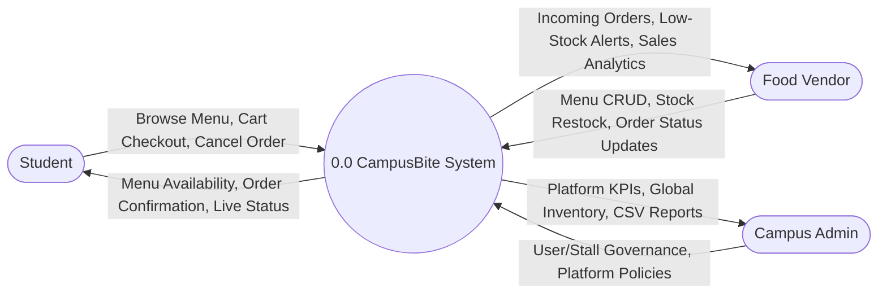
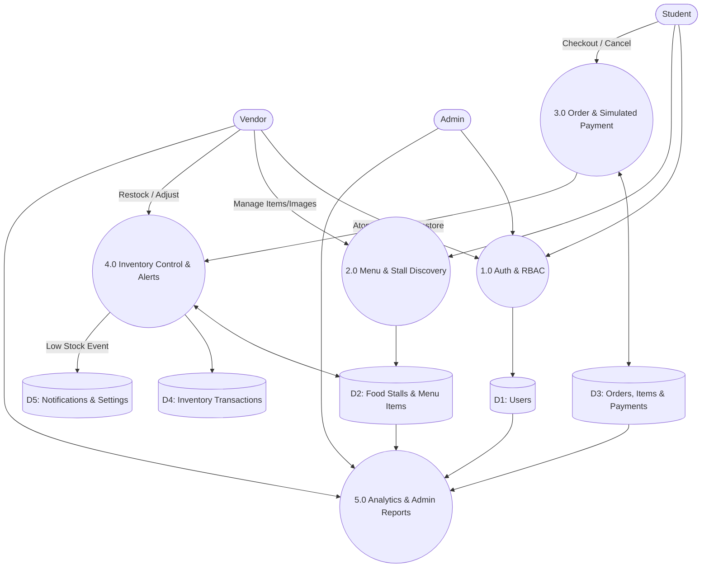

# Data Flow Diagrams (DFD) — CampusBite

## 1. Level 0 — Context Diagram

---

## 2. Level 1 — System Data Flow Diagram

---

## 3. Level 2 — Atomic Order & Inventory Process (Process 3.0 & 4.0)

1. **Validate Request:** Verify student JWT, `platform_settings.allow_ordering`, and `idempotency_key`.
2. **Acquire Write Lock (`BEGIN IMMEDIATE`):** Lock SQLite write transaction.
3. **Verify & Deduct Stock:** Check `stall.is_active`, `stall.is_open`, `menu_item.is_available`, and execute conditional `stock_qty - qty WHERE stock_qty >= qty`. Roll back immediately on failure.
4. **Persist Order & Simulated Payment:** Insert `orders` (`inventory_deducted = 1`), `order_items`, and `payments` (`Paid (Simulated)`).
5. **Append Audit Ledger & Alerts:** Insert `inventory_transactions` (`order_deduction`), emit `new_order` notification, and emit `low_stock` notification if `new_qty <= low_stock_threshold`.
6. **Commit Transaction:** Return confirmed order(s) to student UI.
