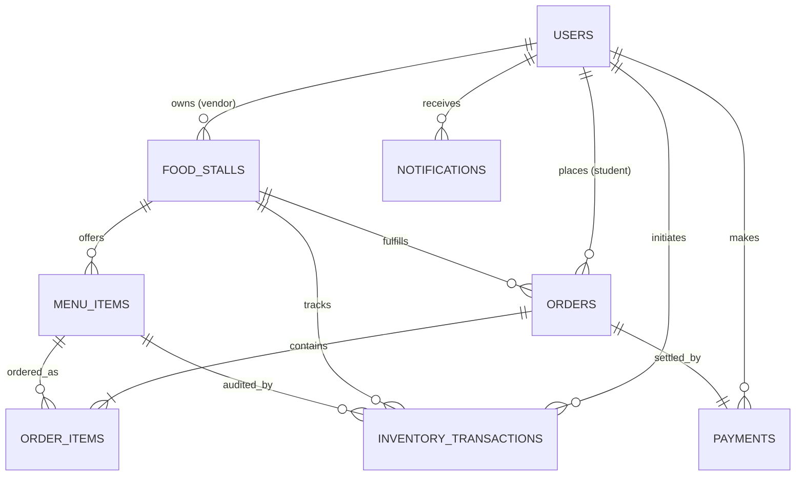

# Database Design — CampusBite

## 1. Entity-Relationship (ER) Overview

CampusBite models **9 core entities** in SQLite (`node:sqlite`) with strict foreign keys (`PRAGMA foreign_keys = ON`), check constraints, ISO-8601 timestamps, and B-tree indexes.

---

## 2. Relational Table Specifications & Indexes

### 2.1 `users`
- **PK:** `id` (TEXT)
- **Columns:** `name`, `email` (UNIQUE), `password_hash`, `role` (`student` | `vendor` | `admin`), `campus_id`, `phone`, `is_active`, `created_at`, `updated_at`
- **Indexes:** `idx_users_email`, `idx_users_role`

### 2.2 `food_stalls`
- **PK:** `id` (TEXT)
- **FK:** `vendor_id -> users(id)`
- **Columns:** `name`, `slug` (UNIQUE), `description`, `cuisine_type`, `location`, `opening_hours`, `avg_prep_minutes`, `rating`, `image_url`, `is_open`, `is_active`, `created_at`, `updated_at`
- **Indexes:** `idx_stalls_vendor_id`, `idx_stalls_is_active`

### 2.3 `menu_items`
- **PK:** `id` (TEXT)
- **FK:** `stall_id -> food_stalls(id)`
- **Columns:** `name`, `description`, `category`, `price` (`>= 0`), `image_url`, `is_veg`, `is_bestseller`, `prep_minutes`, `stock_qty` (`>= 0`), `low_stock_threshold`, `is_available`, `created_at`, `updated_at`
- **Indexes:** `idx_menu_stall_id`, `idx_menu_category`, `idx_menu_stock`

### 2.4 `orders`
- **PK:** `id` (TEXT)
- **FKs:** `student_id -> users(id)`, `stall_id -> food_stalls(id)`
- **Columns:** `order_code` (UNIQUE), `subtotal`, `tax_amount`, `platform_fee`, `total_amount`, `status` (`Placed`, `Accepted`, `Preparing`, `Ready`, `Completed`, `Rejected`, `Cancelled`), `pickup_time`, `special_instructions`, `cancellation_reason`, `idempotency_key` (UNIQUE), `inventory_deducted` (0/1), `inventory_restored` (0/1), `created_at`, `updated_at`
- **Indexes:** `idx_orders_student_id`, `idx_orders_stall_id`, `idx_orders_status`, `idx_orders_created_at`

### 2.5 `order_items`
- **PK:** `id` (TEXT)
- **FKs:** `order_id -> orders(id)`, `menu_item_id -> menu_items(id)`
- **Columns:** `item_name` (price/name snapshot), `unit_price`, `quantity` (`> 0`), `line_total`
- **Indexes:** `idx_order_items_order_id`, `idx_order_items_menu_item_id`

### 2.6 `payments`
- **PK:** `id` (TEXT)
- **FKs:** `order_id -> orders(id)` (UNIQUE 1:1), `student_id -> users(id)`
- **Columns:** `amount`, `method`, `status` (`Pending`, `Paid (Simulated)`, `Refunded (Simulated)`, `Failed`), `transaction_ref` (UNIQUE), `is_simulated`, `created_at`, `updated_at`
- **Indexes:** `idx_payments_order_id`, `idx_payments_student_id`

### 2.7 `inventory_transactions`
- **PK:** `id` (TEXT)
- **FKs:** `menu_item_id -> menu_items(id)`, `stall_id -> food_stalls(id)`, `created_by -> users(id)`
- **Columns:** `type` (`order_deduction`, `restock`, `cancellation_restore`, `rejection_restore`, `manual_adjustment`), `previous_qty`, `change_qty`, `new_qty`, `reference_id`, `note`, `created_at`
- **Indexes:** `idx_inv_tx_item`, `idx_inv_tx_stall`, `idx_inv_tx_created`

### 2.8 `notifications`
- **PK:** `id` (TEXT)
- **FK:** `user_id -> users(id)`
- **Columns:** `role_target`, `type` (`order_update`, `new_order`, `low_stock`, `system`), `title`, `message`, `reference_id`, `is_read`, `created_at`
- **Indexes:** `idx_notif_user_read`

### 2.9 `platform_settings`
- **PK:** `id` (INTEGER, constrained to `1`)
- **Columns:** `campus_name`, `tax_rate_percent`, `platform_fee_flat`, `allow_ordering`, `cancellable_statuses`, `default_low_stock_threshold`, `updated_at`

---

## 3. Concurrency & Data Consistency Guarantees
1. **Atomic Stock Deduction:** Inside `BEGIN IMMEDIATE`, `UPDATE menu_items SET stock_qty = stock_qty - ? WHERE id = ? AND stock_qty >= ? AND is_available = 1`. If `changes !== 1`, the transaction rolls back with HTTP `409 Conflict`.
2. **Idempotency Protection:** `orders.idempotency_key` has a `UNIQUE` index so network retries return the existing order without deducting inventory a second time.
3. **Single-Restore Guarantee:** `inventory_restored` is checked and flipped inside the same transaction during cancellation/rejection so stock cannot be credited twice.

---

## 4. Equivalent MongoDB / Mongoose Document Mapping
For deployments using MongoDB 6+ replica sets (required for multi-document ACID transactions):
- `users`, `foodStalls`, `menuItems`, `orders` (embedding `orderItems[]` + `payment` subdocument or referencing `payments`), `inventoryTransactions`, and `notifications` map directly 1:1 to collections with compound indexes `{ stallId: 1, stockQty: 1 }` and `{ orderCode: 1 }` unique.
