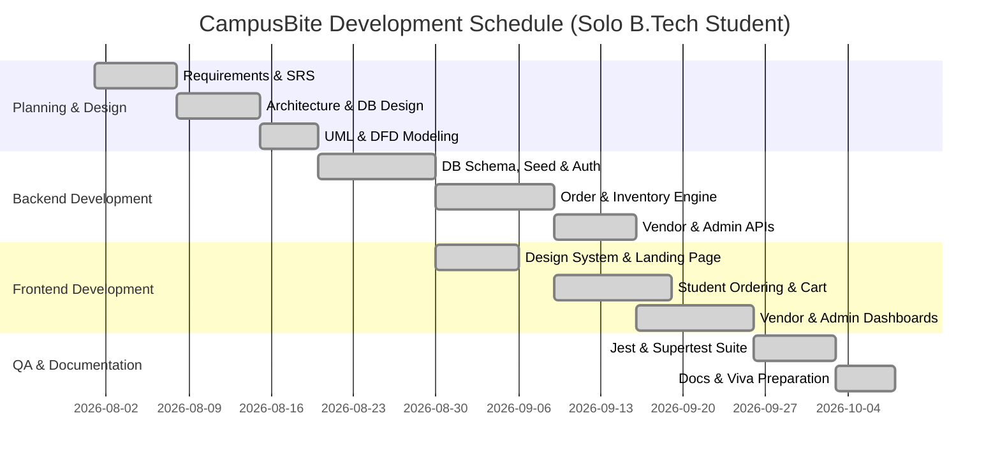

# Project Plan — CampusBite (Solo B.Tech Developer)

## 1. Work Breakdown Structure (WBS)

- **1.0 Initiation & Requirements**
  - 1.1 Campus dining workflow analysis & problem definition
  - 1.2 SRS & user story specification
- **2.0 System & Database Design**
  - 2.1 Modular architecture & REST API contract
  - 2.2 Relational ER schema, indexes & concurrency strategy
  - 2.3 UML & DFD diagrams
- **3.0 Backend Engineering**
  - 3.1 SQLite schema & deterministic seed script
  - 3.2 JWT authentication, bcrypt hashing & RBAC middleware
  - 3.3 Atomic order + inventory transaction engine
  - 3.4 Vendor/Admin analytics & CSV export APIs
- **4.0 Frontend Engineering**
  - 4.1 Design system, typography & food photography assets
  - 4.2 Landing page & Auth modal
  - 4.3 Student discovery, cart drawer & live order tracker
  - 4.4 Vendor kitchen console & Recharts dashboard
  - 4.5 Admin enterprise governance console
- **5.0 Testing & Documentation**
  - 5.1 Unit tests (pricing, cancellation, state machine)
  - 5.2 Integration tests (Supertest API & RBAC & stock concurrency)
  - 5.3 Documentation suite (`/docs/*`) & README

---

## 2. Gantt Chart (10-Week Academic Semester Plan)

---

## 3. Effort Estimation (Solo Developer — COCOMO / Story-Point Adapted)

| Module | Estimated Effort (Hours) | Complexity |
| :--- | :---: | :--- |
| Requirements, Architecture & UML | 18 hrs | Medium |
| Database Schema, Seed & Auth/RBAC | 20 hrs | Medium |
| Atomic Order & Inventory Service | 24 hrs | High |
| Landing Page & Student Dashboard | 28 hrs | High |
| Vendor & Admin Dashboards + Charts | 30 hrs | High |
| Automated Testing (Jest/Supertest) | 14 hrs | Medium |
| Documentation & User Manual | 16 hrs | Medium |
| **Total Estimated Effort** | **150 hrs** | **~10 Weeks (15 hrs/wk)** |

---

## 4. Key Milestones
- **M1 (Week 3):** Approved SRS, ER Schema, and Architecture Blueprint.
- **M2 (Week 6):** Working REST API with JWT Auth and atomic inventory transactions.
- **M3 (Week 8):** Complete Frontend across Landing, Student, Vendor, and Admin views.
- **M4 (Week 10):** 100% passing unit & integration test suite, production build, and complete `/docs` report.
